# Slign

<p align="center">
  <picture>
    <source media="(prefers-color-scheme: dark)" srcset="docs/img/hero-dark.svg">
    
  </picture>
</p>

Teach your coding agent to draw. Slign is a skill for hand-inked isometric
illustrations that come alive on hover: one ink, a little face, no fills, no
JavaScript.

Ask your agent for "an illustration for the empty state" and it draws your
product's own thing in this style, sizes it to the text around it, and places
it in the page as one self-contained SVG.

<p>
  <picture>
    <source media="(prefers-color-scheme: dark)" srcset="docs/img/laptop-dark.svg">
    
  </picture>
  <picture>
    <source media="(prefers-color-scheme: dark)" srcset="docs/img/server-dark.svg">
    
  </picture>
  <picture>
    <source media="(prefers-color-scheme: dark)" srcset="docs/img/database-dark.svg">
    
  </picture>
  <picture>
    <source media="(prefers-color-scheme: dark)" srcset="docs/img/cloud-dark.svg">
    
  </picture>
  <picture>
    <source media="(prefers-color-scheme: dark)" srcset="docs/img/terminal-dark.svg">
    
  </picture>
  <picture>
    <source media="(prefers-color-scheme: dark)" srcset="docs/img/rocket-dark.svg">
    
  </picture>
</p>

## Install

**Claude Code**

```
/plugin install slign --marketplace andss-ye/slign
```

On versions before 2.1.275, add the marketplace first:

```
/plugin marketplace add andss-ye/slign
/plugin install slign@slign
```

**Any agent that reads Agent Skills**

```
npx skills add andss-ye/slign
```

It installs into `.agents/skills/slign` and links it for Claude Code. Or copy the
`skills/slign` folder into your agent's skills directory.

It needs Node 20 or newer and nothing else.

## Use

Just ask. The skill triggers when you want a drawn object for a page: a hero,
a feature card, an empty state, a 404.

> Add a small illustration to the empty state on the alerts page.

The drawing is inline SVG. It takes the color of the text around it and sizes
in `em`, so it follows your type. Tune it from CSS:

```css
.slign {
  color: #2a17d4;        /* ink */
  --slign-size: 8em;     /* width; never wider than its container */
  --slign-stroke: 3;     /* line weight */
}
```

Add `data-slign-trigger` to a card or a button and the drawing plays its gesture
when that element is hovered, focused or tapped.

## The style

- One ink: every mark is a `currentColor` stroke.
- Thick, round, slightly unsteady lines over a true isometric projection.
- A face, and one gesture that suits the object.
- Motion is CSS only, limited to `transform` and `opacity`, and switches off
  under `prefers-reduced-motion`.
- Safe to put many on one page: no ids, every class and keyframe is scoped.

Three styles, picked with `style` in the object file: `ink` (the default, above),
`hairline` (precise thin lines with a gradient) and `engrave` (hatching and
stipple on paper).

The reference objects live in [`skills/slign/examples`](skills/slign/examples).

## Contribute

New reference objects and fixes are welcome. See [CONTRIBUTING.md](CONTRIBUTING.md).

## License

MIT
